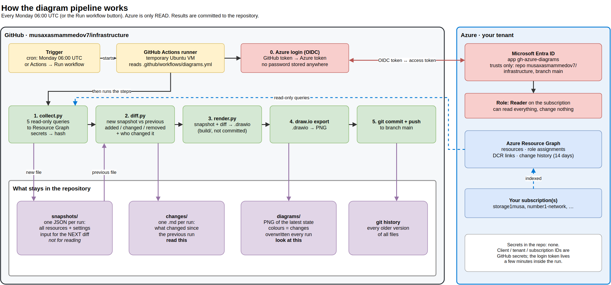

# Azure infrastructure diagrams

Weekly, automatic, read-only.

1. GitHub Actions logs in to Azure with OIDC (no stored password) as an identity with the `Reader` role.
2. `scripts/collect.py` queries Azure Resource Graph and saves `snapshots/<date>.json`
   (webhook URLs, e-mails, keys and Logic App definitions are replaced by a hash).
3. `scripts/diff.py` compares it with the previous run and writes `changes/<date>.md`:
   added / changed (old → new) / removed, and who did it (Azure change history, last 8 days).
4. `scripts/render.py` builds draw.io diagrams in [`diagrams/`](diagrams/README.md)
   (overview, network, one page per environment — similar environments share one page — and monitoring);
   draw.io exports them to PNG.
5. The workflow commits the results. Runs every Monday 06:00 UTC, or manually:
   Actions → azure-diagrams → Run workflow.

Diagrams show the current state only. Red border = open to the Internet. Changes: `changes/<date>.md`.

Keep the repository **private** for real infrastructure: snapshots contain IP addresses and open ports.
The workflow refuses to run in a public repository unless `ALLOW_PUBLIC_REPO` is "true" in the workflow file.
