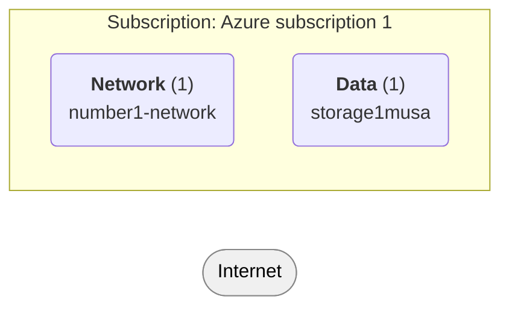

# Overview — 2026-11-25

Subscriptions and what is inside them. Arrows = one resource references another.

Legend: green = added · yellow = changed · red dashed = removed (shown for one run) · red solid = risk · grey = outside this diagram

