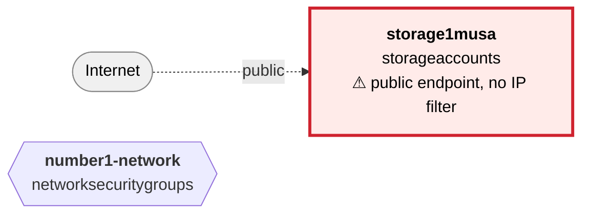

# Network — 2026-11-25

VNets, subnets, NSGs with rules open to the Internet, public IPs, public PaaS endpoints.

Legend: green = added · yellow = changed · red dashed = removed (shown for one run) · red solid = risk · grey = outside this diagram

