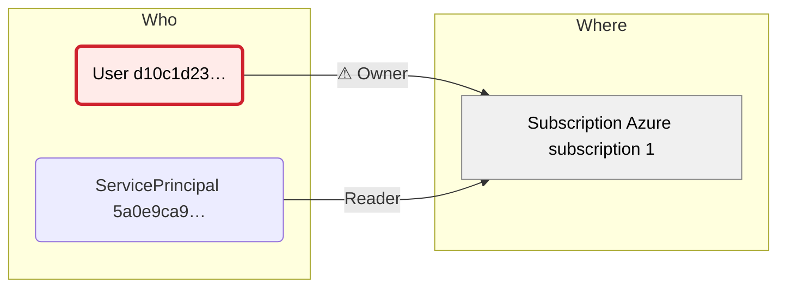

# Access — 2026-11-25

Role assignments: who has which role on which scope. ⚠ = Owner/Contributor/User Access Admin.

Legend: green = added · yellow = changed · red dashed = removed (shown for one run) · red solid = risk · grey = outside this diagram

