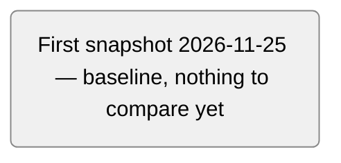

# Changes — 2026-11-25

What was added, changed or removed since the previous snapshot.

Legend: green = added · yellow = changed · red dashed = removed (shown for one run) · red solid = risk · grey = outside this diagram

